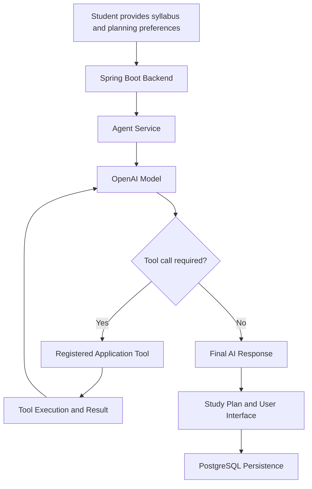
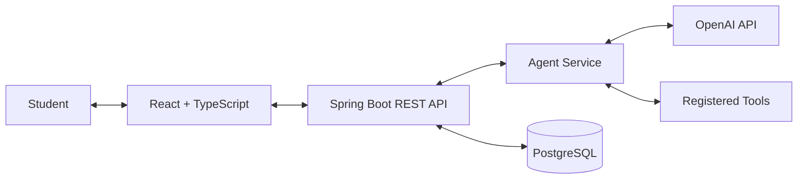

# Studyflow — Agentic AI Study Planner

<p align="center">
  
</p>

<p align="center">
  An AI-powered study planning application that helps students transform their syllabus, deadlines, and availability into an organized study plan.
</p>

<p align="center">
  
  
  
  
</p>

<p align="center">
  <a href="https://github.com/LokeshPatnaik/studyflow-ai-study-planner">Repository</a> •
  <a href="#-about-the-project">About</a> •
  <a href="#-agentic-ai-how-it-works">Agentic AI</a> •
  <a href="#-technology-stack">Tech Stack</a> •
  <a href="#-getting-started">Setup</a>
</p>

---

## 📌 About the Project

**Studyflow** is an Agentic AI-based personalized study planner designed to make academic planning more organized and manageable.

Students often struggle to break down a large syllabus, estimate the time required for each topic, manage multiple subjects, and prepare for exams without last-minute pressure.

Studyflow addresses this problem by combining a full-stack web application with an AI-powered, tool-based workflow.

Instead of treating study planning as only a timetable-generation problem, the project explores how a language model can work with application tools to support a structured planning process.

### 🎯 Project Objectives

- Organize syllabus content into meaningful study topics.
- Help students estimate the time required for individual topics.
- Generate study plans around deadlines and available study time.
- Support changes to topics and schedules as planning needs evolve.
- Demonstrate how LLM function calling can connect AI reasoning with real application operations.

## 🤖 Agentic AI — The Core of Studyflow

**The central idea is to move beyond an AI that only generates text toward an AI workflow that can use tools to help accomplish a goal.**

Studyflow integrates the OpenAI API with a function-calling client and a registered set of application tools.

### Which AI technology does it use?

| Component | Role |
|---|---|
| OpenAI API | Provides access to the language model used for AI-related tasks. |
| OpenAI function calling | Allows the model to request supported application tools using structured arguments. |
| `OpenAiFunctionCallingClient.java` | Connects the backend's agent workflow to the model's function-calling interface. |
| `AgentService.java` | Coordinates the agent workflow. |
| `AgentToolRegistry.java` | Defines or registers the tools available to the agent. |
| `SyllabusTopicParser.java` | Supports parsing syllabus content into topics. |
| `SyllabusTopicGrouper.java` | Supports grouping syllabus content into more meaningful study units. |

The example configuration specifies `gpt-4o-mini` as the OpenAI model. The actual model used depends on the runtime configuration.

### How does the Agentic AI workflow work?



The diagram represents the intended tool-calling interaction at a high level. The precise execution sequence depends on the implemented agent workflow.

### What makes this agentic?

- **Model integration:** the application can use a language model for supported AI tasks.
- **Tool calling:** the model can request registered tools instead of only returning a plain-text answer.
- **Application execution:** the backend handles supported tool operations.
- **Result-based workflow:** tool results can be returned to the model as part of a function-calling interaction.
- **Structured application:** Java services, the database, and the frontend make the resulting study-planning workflow usable.

> **Important distinction:** The OpenAI model provides language-model intelligence; Spring Boot executes application operations; PostgreSQL stores application data. The model does not automatically control the entire application, and ordinary scheduling rules should not be described as AI reasoning unless they actually use the model.

## ✨ Key Features

### 📚 Syllabus Organization
- Parse syllabus content into study topics.
- Group related content into manageable learning units.
- Review and adjust topics before using them in a plan.

### 🧠 Personalized Study Planning
- Organize study activities around deadlines and availability.
- Account for planning preferences and time constraints.
- Estimate topic duration and distribute study work across available time.

### 📅 Schedule Management
- Organize planned study sessions.
- Review and revise planning decisions when requirements change.
- Keep study planning information organized in the application.

### 🔄 Revision and Progress Support
- Support structured revision planning.
- Review planned activities and make adjustments where supported by the application.
- Keep planning data persistent through the backend and database.

*Feature availability and exact behavior depend on the implemented application version.*

## 🏗️ System Architecture

Studyflow follows a full-stack architecture:



### Architecture Layers

**Frontend — React and TypeScript**
- Presents the user interface.
- Collects syllabus and study-planning information.
- Displays planning results and application data.

**Backend — Java and Spring Boot**
- Exposes application APIs.
- Coordinates application services and agent workflows.
- Validates requests and manages interactions with the database.

**AI Layer — OpenAI API**
- Supports language-model tasks.
- Uses function calling to request registered tools where appropriate.
- Participates in the agent workflow implemented by the backend.

**Database — PostgreSQL**
- Stores persistent application data.
- Supports retrieval and management of study-planning information.

## 🛠️ Technology Stack

| Technology | Purpose |
|---|---|
| Java 21 | Backend programming language |
| Spring Boot | REST APIs and backend services |
| React | User interface |
| TypeScript | Frontend type safety |
| PostgreSQL | Relational database |
| OpenAI API | Language-model integration |
| OpenAI function calling | Structured requests for application tools |
| Maven | Backend dependency management and builds |
| npm | Frontend dependency management |
| Git and GitHub | Version control and source-code hosting |

## 📂 Project Structure

```text
studyflow-ai-study-planner/
├── backend/
│   ├── src/
│   │   ├── main/
│   │   │   ├── java/
│   │   │   │   └── .../agent/
│   │   │   │       ├── AgentService.java
│   │   │   │       ├── AgentToolRegistry.java
│   │   │   │       ├── OpenAiFunctionCallingClient.java
│   │   │   │       ├── SyllabusTopicParser.java
│   │   │   │       └── SyllabusTopicGrouper.java
│   │   │   └── resources/
│   │   └── test/
│   └── pom.xml
├── frontend/
│   ├── src/
│   ├── package.json
│   └── ...
├── docs/
├── scripts/
├── docker-compose.yml
├── .env.example
├── .gitignore
└── README.md
```

## 🚀 Getting Started

### Prerequisites

Install the following tools before running the application:

- Java 21
- Maven
- Node.js and npm
- PostgreSQL
- Git

An OpenAI API key is needed for model-backed functionality when it is enabled in the application configuration.

### 1. Clone the repository

```bash
git clone https://github.com/LokeshPatnaik/studyflow-ai-study-planner.git
cd studyflow-ai-study-planner
```

### 2. Configure environment variables

Use `.env.example` as a reference for the required configuration.

Configure the variables in your terminal or local environment. For the local backend, the application uses the following settings:

```text
DATABASE_URL=jdbc:postgresql://localhost:5432/study_planner
DATABASE_USERNAME=planner
DATABASE_PASSWORD=your_local_database_password
OPENAI_API_KEY=your_openai_api_key
OPENAI_MODEL=gpt-4o-mini
APP_ORIGIN=http://localhost:5173
```

Use your own local database credentials. Do not commit real API keys or passwords to GitHub.

### 3. Prepare PostgreSQL

Create a PostgreSQL database and user matching your local configuration. Ensure PostgreSQL is running before starting the backend.

Database migrations are managed by the application's configured migration system.

### 4. Start the backend

Open a terminal:

```powershell
cd backend

$env:DATABASE_URL = "jdbc:postgresql://localhost:5432/study_planner"
$env:DATABASE_USERNAME = "planner"
$env:DATABASE_PASSWORD = Read-Host "Enter your database password"

mvn spring-boot:run
```

The backend is expected to run at:

`http://localhost:8080`

### 5. Start the frontend

Open a second terminal:

```powershell
cd frontend
npm install
npm run dev -- --host 127.0.0.1
```

Open the frontend URL printed by Vite, normally:

`http://127.0.0.1:5173`

### Configuration Notes

- Configure the OpenAI API key only in your local environment or deployment secret settings.
- Keep database credentials private.
- Confirm the required environment variables against the application configuration before deploying.
- The example configuration is a template; it does not contain production credentials.

## 🔐 Security

- Never commit API keys, database passwords, or other secrets.
- Keep local `.env` files out of version control.
- Use environment variables or the hosting provider's secret manager for deployment.
- Review authentication, authorization, session handling, and production database access before exposing the application publicly.

## 🧪 Testing

Run backend tests from the `backend` directory:

```bash
mvn test
```

Run frontend tests using the scripts defined in `frontend/package.json`. For example, if the project provides a test script:

```bash
npm test
```

A successful local run is not a substitute for verifying a deployed application and its external services.

## 🗺️ Future Improvements

Potential areas for further development include:

- More adaptive planning based on study progress.
- Better explanations of why a schedule was generated.
- More robust handling of missed sessions and changed deadlines.
- Clearer visibility into agent tool calls and their results.
- Additional evaluation of AI-generated outputs and tool-call reliability.
- Deployment monitoring and production readiness improvements.

## 🎓 Learning Outcomes

This project explores practical full-stack development and the integration of language models with backend application logic.

It brings together:

- Agentic AI concepts and function calling.
- Java and Spring Boot backend development.
- React and TypeScript frontend development.
- Relational database integration using PostgreSQL.
- Environment configuration, version control, and application architecture.

---

<p align="center">
  <b>Studyflow — Plan with clarity. Study with purpose.</b>
</p>
