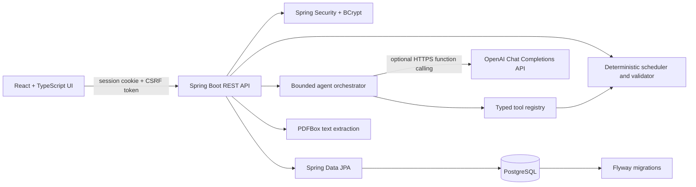
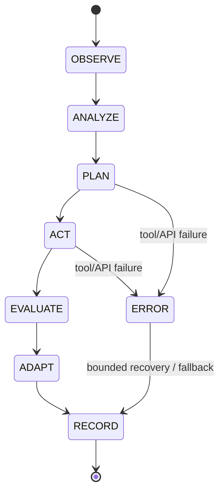
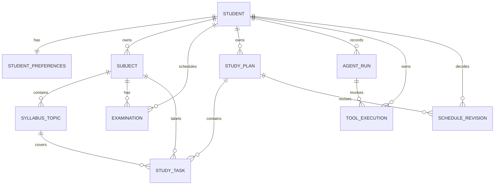

# Architecture and API

## Runtime architecture



The frontend has no direct database or OpenAI credentials. Authenticated endpoints are scoped to the student resolved from the server-side session. Browser mutations send the cookie-backed `X-XSRF-TOKEN` header. Passwords are BCrypt hashes. PDF uploads are limited to 10 MB and use PDFBox selectable-text extraction. Image-only PDFs are identified as requiring OCR; OCR is not implemented.

## Agent workflow



The workflow is one bounded run with a maximum of five model-selected tool calls, at most four API rounds, and no self-repeating loop. The model receives typed tool schemas and can only invoke registered functions. The backend binds every tool call to the authenticated student, validates arguments, logs result status, and applies deterministic schedule checks. If the API key is missing or an API call fails before a consequential action, rule-based planning remains available and is labeled in the activity history. Significant revisions remain pending until the student approves them.

## Registered tools

| Tool | Purpose | Side effects |
| --- | --- | --- |
| `parse_syllabus` | Extract likely unit/topic lines from selectable text | None |
| `get_student_preferences` | Read current saved preferences | None |
| `get_available_time` | Calculate weekly study capacity | None |
| `get_exam_deadlines` | Read the student's exam dates | None |
| `estimate_topic_duration` | Suggest bounded topic duration | None |
| `generate_study_plan` | Generate and persist an inactive candidate | Draft only |
| `validate_study_plan` | Recheck overlap/deadline constraints | None |
| `create_study_tasks` | Confirm saved candidate tasks are reviewable | Draft only |
| `get_progress` | Read task completion state | None |
| `propose_reschedule` | Create a revision candidate | Pending proposal |
| `apply_approved_reschedule` | Apply a revision already approved by the student | Approved revision only |

No model tool has unrestricted database access, shell access, or authority to approve a plan/revision.

## Data model



Flyway migrations `V1__initial_schema.sql` and `V2__editable_topics_and_plan_workflows.sql` create/extend foreign keys, indexes, and duration/time constraints. V2 is additive: it preserves existing syllabus topics and tasks while adding topic editing/inclusion fields and session metadata. Task statuses preserve history (`PROPOSED`, `PLANNED`, `COMPLETED`, `MISSED`, `MOVED`, `ARCHIVED`).

## REST API

Base path: `/api/v1`. The OpenAPI UI is at `/swagger-ui/index.html` when the backend is running.

| Method | Path | Description |
| --- | --- | --- |
| GET | `/auth/csrf` | Obtain the browser CSRF token |
| POST | `/auth/register` | Create student account |
| POST | `/auth/login` | Start authenticated session |
| POST | `/auth/logout` | End session |
| GET | `/auth/me` | Current profile |
| GET / PUT | `/preferences` | Read/update availability and revision preferences |
| GET / POST | `/subjects` | List/create subjects and their first exam |
| GET / POST | `/exams` | List/create exams |
| GET | `/subjects/{id}/topics` | List approved syllabus topics |
| PATCH | `/subjects/{id}/topics/{topicId}` | Edit topic hierarchy, description, estimate, importance, familiarity, and plan inclusion |
| POST | `/syllabus/upload` | Extract PDF text and suggest editable topics |
| POST | `/syllabus/manual` | Save manually entered/approved topics |
| GET | `/plans` | List plan history |
| GET | `/plans/active` | Read active plan |
| POST | `/plans/generate` | Build a deterministic draft candidate |
| POST | `/plans/{id}/approve` | Explicitly activate a draft |
| PATCH | `/plans/{id}/status` | Pause, resume, or archive an owned plan |
| GET | `/tasks` | List/search/filter student tasks |
| PATCH | `/tasks/{id}/status` | Complete, miss, or reopen a task |
| PATCH | `/tasks/{id}/schedule` | Move an unfinished task within saved availability, capacity, and exam bounds |
| GET | `/analytics` | Database-backed task/subject/week totals |
| POST | `/agent/run` | Run `GENERATE_PLAN`, `ADAPT_PLAN`, or `REVIEW_PROGRESS` workflow |
| GET | `/agent/activity` | Agent runs and their tool calls |
| GET | `/agent/tools` | Recent tool call history |
| GET | `/revisions` | List revision history |
| POST | `/revisions/propose` | Build a schedule revision candidate |
| POST | `/revisions/{id}/decision` | Approve/apply or reject a proposal |

Example requests:

```http
POST /api/v1/subjects
Content-Type: application/json
X-XSRF-TOKEN: <cookie token>

{"name":"Algorithms","color":"#9b8cff","priority":5,"examName":"Midterm","examDate":"2026-11-02"}
```

```http
POST /api/v1/syllabus/manual
Content-Type: application/json
X-XSRF-TOKEN: <cookie token>

{"subjectId":"<subject-uuid>","topics":[{"title":"Graph traversal","unit":"Unit 3","difficulty":"HARD","estimatedMinutes":90}]}
```

```http
POST /api/v1/agent/run
Content-Type: application/json
X-XSRF-TOKEN: <cookie token>

{"intent":"GENERATE_PLAN","note":"Keep sessions near 50 minutes"}
```

The scheduler returns a non-persisted conflict response when topics cannot fit before deadlines. Do not treat an infeasible plan as approved.

## Development notes and limitations

- PDF uploads use PDFBox to extract selectable text. When `OPENAI_API_KEY` is configured, a forced, schema-constrained `parse_syllabus` function call returns bounded topic suggestions; otherwise the deterministic local extractor is clearly identified. AI errors fall back to the local extractor. Image-only PDFs need OCR, which this build does not include.
- The optional OpenAI integration uses the Chat Completions function calling format. Availability and the selected model depend on the API account; set `OPENAI_MODEL` to a model enabled for that account.
- Schedule allocation uses saved daily windows and preferences, then deterministically checks conflicts and deadlines. It is a course-project planner, not a calendar-provider integration.
- The planner creates learning sessions and spaced recall sessions. After all learning chunks for a topic are completed, it adds up to three 25-minute reviews around 1, 3, and 7 days later when available-day, time-window, daily-capacity, break, and exam constraints allow. Repeated completion is idempotent; a review is skipped when no valid slot remains.
- Topic edits and plan inclusion are persisted and owner-scoped. The calendar offers week and month views; moving an unfinished session persists it after validating the requested time against saved preferences and exam dates.
- The current syllabus model supports unit/chapter/topic hierarchy, not nested subtopics, and stores source filename plus original title/unit rather than the uploaded PDF binary or full extracted text. Excluding a topic keeps it in the library but omits it from schedule generation.
- Dedicated practice-question, mock-test, final-review, holiday/blocked-calendar, actual-duration, confidence, and per-plan version workflows are not yet implemented. Existing schedule revisions remain proposals that students approve before application.
- Demo data is created only for `demo@planner.local` when `DEMO_MODE=true`; it is marked as demo data.
- The dashboard landing preview is illustrative marketing content. The authenticated dashboard and analytics are API-backed.

